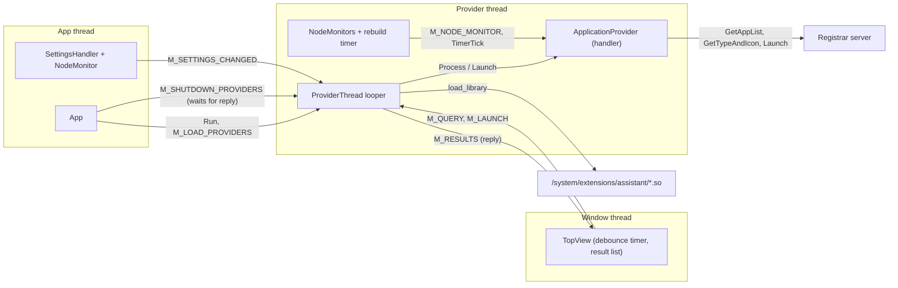
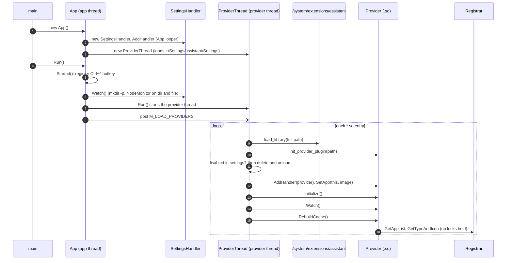
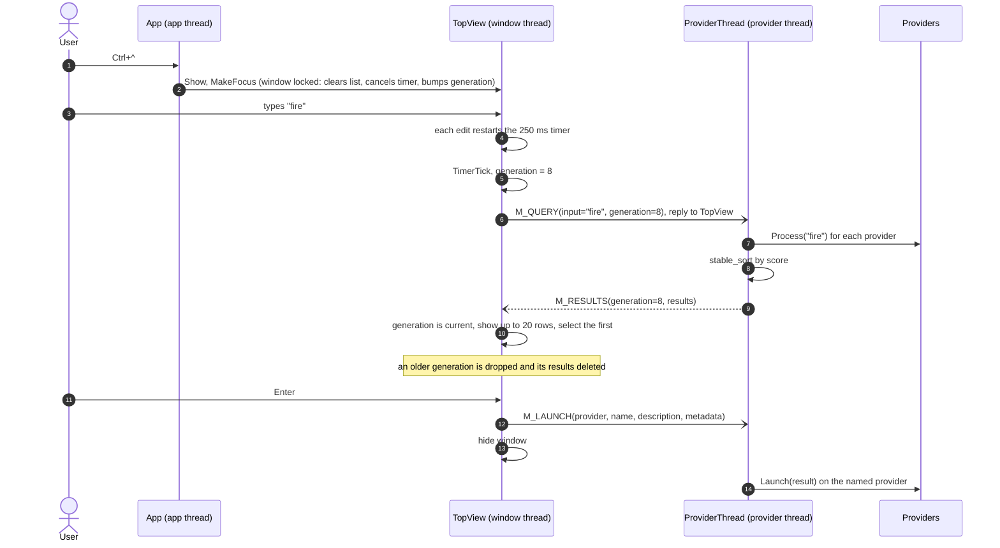
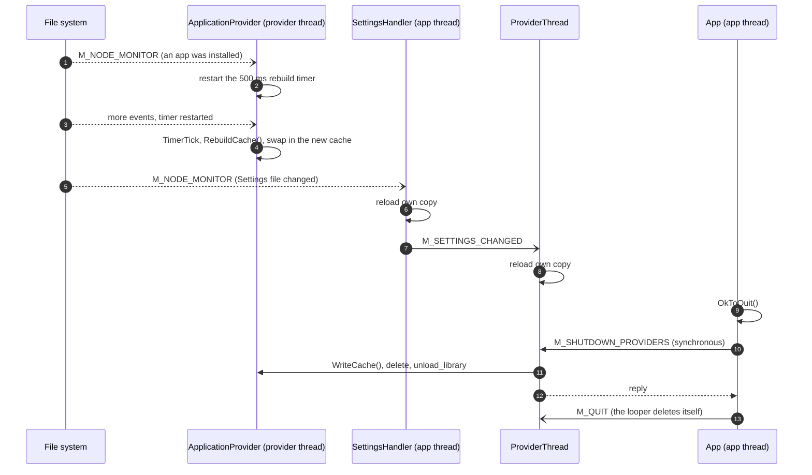

# Assistant: how provider plugins work

Source: `Syllable/system/apps/desktop/assistant` (updated 2026-10-29, after the threading rework). In this code a "plugin" is a **provider**: a shared library that builds its own list of results and searches it. `ApplicationProvider` (`application.so`) is the only one in the build. File, Menu and Vault are stubs and are left out.

## The pieces

| Piece | File | Thread | Role |
|---|---|---|---|
| `App` (`os::Application`) | `application.cpp` | App looper | Registers the Ctrl+`^` hotkey, starts the provider thread, and shuts it down on quit. |
| `SettingsHandler` (`os::Handler`) | `settings.cpp` | App looper | Watches `~/Settings/assistant` and tells the provider thread when the settings change. |
| `MainWindow` (`os::Window`) | `mainwindow.cpp` | Window looper | Borderless popup. Esc hides it. |
| `TopView` (`os::View`) | `top_view.cpp` | Window looper | Text box and result list. Debounces typing, sends queries, shows results, launches the selection. |
| `ProviderThread` (`os::Looper`) | `provider_thread.cpp` | Provider looper | Owns every plugin. Loads them, runs queries, launches results. |
| `assistant::Provider` (`os::Handler`) | `providers/provider.h` | Provider looper | Abstract plugin interface. |
| `assistant::Result` | `providers/result.h` | any (copied) | One hit: provider, name, description, icon, score, and a metadata map. |
| `ListViewDisplayRow` | `gui/row.cpp` | Window looper | Draws one `Result` in the list. |

## Threading model

There are three threads, and each one owns its own data:

- The **App thread** handles the hotkey and the app settings.
- The **Window thread** handles typing, the result list and the timers.
- The **Provider thread** owns the plugin list and every plugin. All plugin code runs on this thread: `Initialize`, `Watch`, `RebuildCache`, `Process`, `Launch`, `WriteCache`, and the plugin's node-monitor events and timers.

The threads only talk through messages (`messages.h`), so the app code has no locks of its own. A plugin needs no locks either, unless it starts a thread of its own.

There is one rule about waiting. The App thread can wait on the Provider thread: `M_SHUTDOWN_PROVIDERS` is sent synchronously on quit. So the Provider thread must never wait on the App thread or the Window thread. It only posts replies to them. Plugins must follow the same rule.



## The plugin contract

A plugin is a `.so` in `/system/extensions/assistant/` that exports one C symbol:

```cpp
extern "C" assistant::Provider* init_provider_plugin( os::Path cPluginFile );
```

It returns a new `Provider` subclass, which implements:

| Method | When it is called |
|---|---|
| `Initialize()` | Once, after the provider has been added to the provider looper. A non-zero return unloads the plugin. |
| `Watch()` | Once, after `Initialize`. Create `NodeMonitor`s with `this` as the target here. |
| `RebuildCache()` | Once at load. After that, whenever the plugin decides to (for example from its own timer). |
| `Process( const os::Variant& )` | On every query. Return matching `Result`s with a score; higher scores sort first. |
| `Launch( const Result& )` | When the user presses Enter on one of this plugin's results. |
| `Settings()` | Returns a `const os::Settings&`. Never copy an `os::Settings`: its copy constructor shares internal state and double-frees. |
| `SettingsView()` | Builds a settings view on the provider thread for the caller to attach to a window. Nothing calls this yet. |
| `WriteCache()` | On shutdown, before the plugin is deleted. |

Helpers for plugins are in `providers/helpers.h` and are inline, so a plugin does not link against the executable:

- `SettingsDirectory( name )` returns `~/Settings/assistant/<name>`.
- `BindSettings( settings, dir )` points an `os::Settings` at `<dir>/Settings` without opening the file. `Save()` creates the directories and the file.
- `MakeDirectories( path )` works like `mkdir -p`.

To turn a plugin off, store a `PluginSettings { bool disabled; }` blob (as `T_RAW`) under the plugin's name in `~/Settings/assistant/Settings`. The change takes effect the next time the Assistant starts.

Result icons are `std::tr1::shared_ptr<os::Image>`. When a cache rebuild drops an icon, it is freed only after the list rows that still show it are gone.

### Writing a new plugin

```cpp
class MyProvider : public assistant::Provider {
public:
    MyProvider() : Provider( "MyProvider" ), m_cSettings( ( os::SeekableIO* )NULL ) {}
    status_t Initialize() {
        BindSettings( m_cSettings, SettingsDirectory( GetName() ) );
        m_cSettings.Load();
        return 0;
    }
    status_t Watch()                                    { return 0; }
    status_t RebuildCache()                             { /* fill m_cCache */ return 0; }
    std::vector<Result> Process( const os::Variant& v ) { /* match v.AsString() against m_cCache */ }
    status_t Launch( const Result& r )                  { return 0; }
    const os::Settings& Settings() const                { return m_cSettings; }
    os::View* SettingsView()                            { return NULL; }
    void WriteCache()                                   {}
private:
    os::Settings m_cSettings;
    std::vector<Result> m_cCache;
};
extern "C" assistant::Provider* init_provider_plugin( os::Path ) { return new MyProvider(); }
```

Build it with `syllable_library(assistant_my SONAME my.so SOURCES provider.cpp LIBS libsyllable STRIP INSTALL system/extensions/assistant)`, and add its directory to `providers/CMakeLists.txt`. The code must build with GCC 4.1.2 (C++98).

## Startup and plugin loading



## A search and a launch



## Live updates and shutdown


